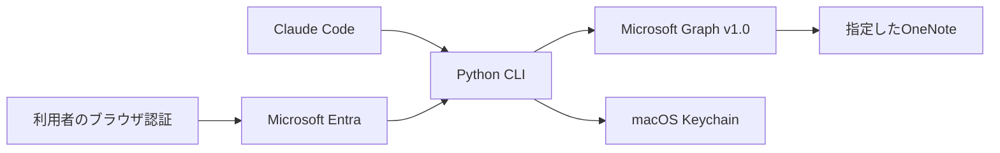
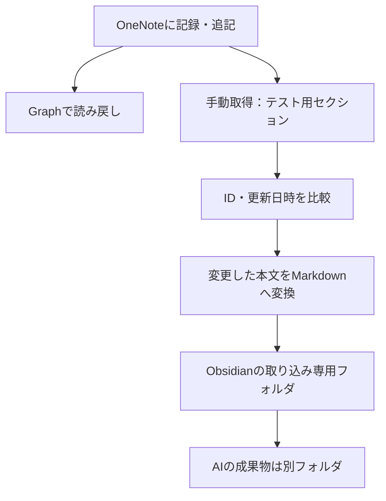

# Claude CodeからOneNoteを読む・書く

## ゴールと完了条件
Microsoft Graph APIを通じて指定したOneNoteセクションにテストページを作成し、本文を読み戻せること。追記後にも再取得して確認する。コードのテスト成功とMicrosoft実環境での成功を区別する。

## 構成

- 最初はClaude Codeのコマンド実行で利用する。MCPサーバーは初期ゴールの必須条件にしない。
- Python標準ライブラリのみ。外部パッケージのインストールなし。
- 公開クライアントの認可コード＋S256 PKCE認証。ブラウザからlocalhost:8765/callbackへ戻す。state照合・ループバック限定待受・コールバックのログ抑止を実装。Notes.ReadWriteとoffline_accessを要求。クライアントシークレットは作らない。
- アクセス/更新トークンはこのツール専用のmacOSキーチェーン項目に保存。既存サービスの認証ファイルを読まず、秘密値をログ・コマンド引数・プロジェクトに出さない。
- 公開設定はアプリID、テナントID、Graphの対象（me または sites/ID）、検証用セクションIDのみ。
- 初回のDevice Code認証は530035（Security Defaults）で拒否されたため通常のブラウザ認証へ変更。組織の保護設定は変更しない。Device Codeは許可された環境だけの任意オプション。
- 共有ノートの追加権限は必要性を確認してから設定する。初期値でNotes.ReadWrite.Allを要求しない。

## 機能
configure / login / status / notebooks / sections / pages / read / create / append / verify / logout。
readは本文HTMLと表示用テキストを返す。create・appendはプレーンテキストをHTMLエスケープする。書き込み先は設定されたセクションに固定する。既存ページの削除・置換は初期版に含めない。

## 境界と障害対応
- Graphへの送信先はhttps://graph.microsoft.com/v1.0の指定OneNoteルートだけ。リダイレクト禁止、ページングURLも検証する。
- GETの429/一時的な5xxのみ回数を限って再試行。POST/PATCHは重複防止のため自動再試行しない。
- Graph/OAuthの生のエラー本文・トークンを表示しない。HTTP状態とエラーコードで切り分ける。
- verifyは新規の架空テストページのみを作成し、作成IDを直ちに表示してから読み戻す。追記・再取得で完了判定する。
- トークン期限切れは更新トークンで更新。再認証が必要ならloginを案内する。

## 確定した接続先と残る範囲
法人Microsoft 365。専用アプリを登録し、本人の委任同意で接続済み。既存「Claude接続テスト_2026-09-14」の「架空データ_読取検証」で実機読み書き成功。実務用の保存先・共有ノート・複数利用者運用は今後の範囲。

Keychainの読取・保存・存在確認・削除はPython ctypesでmacOS Security.frameworkを直接呼ぶ。全操作の前に同じプロセスでSecKeychainSetUserInteractionAllowed(False)を設定し、設定に失敗した場合は認証項目に触れない。旧読取のsecurity子プロセスは20秒のタイムアウトでも許可画面を出してしまったため、2026-09-23に廃止した。保存・更新後に専用項目だけを読み戻して一致確認する。値はプロセス引数・ログ・一時ファイルに出さず、取得したネイティブメモリはfinallyで解放する。OSStatusの失敗はACL変更や自動ロック解除をせず報告する。利用APIはmacOS互換API（deprecated）のため将来のOS対応時にSecItem APIへの移行を検討する。

## next_action
初期ゴール達成。実務保存先を決めた段階でセクション設定・共有権限の必要性を再確認する。継続認証の実機検証はトークン更新時に実施する。

## 2026-09-22 拡張：OneNote正本＋Obsidianへの一方向反映
ユーザーが両経路の構築と実演を指示。既存接続を拡張する。

- 直接読み書きは既存onenote.py、同期は追加sync.py。OneNoteを正本とし、同期処理から書き戻さない。
- 既存Keychain認証を再利用。対象は設定済みの架空データ用セクション。demo-vaultを開発プロジェクト内に作り、共有Z-Vaultへは入れない。
- 軽量メタデータをページングし、ID・更新日時から変更した本文だけ取得。固定IDのファイル名で重複を防ぐ。
- 取得ファイルの手編集はハッシュで検出し、上書きせず競合を報告。AI成果物フォルダには同期処理から書かない。
- 完全な一覧取得に成功した場合のみ未検出ページを報告。元ページやローカルファイルは削除しない。
- 見出し・段落・リスト・リンク・表を変換。画像・添付は許可されたGraph resourceだけ取得し、取得失敗・未対応を明記。手書きの意味解析や完全なレイアウト再現は保証しない。
- 原子的保存、プロセスロック、シンボリックリンク拒否、リクエスト数予算を実装。部分完了から再開できる。
- 過去に30分間隔の定期実行を登録したが現在はPAUSED。最新ユーザー指示により必要時の手動実行のみ。認証復旧後も自動再開しない。
- 完成条件：直接作成・読取・追記、初回取り込み、変更反映、無変更時の再取得抑止、競合保護、定期実行登録、デモ証跡とヒアリング項目。

## 2026-10-18 追加：ターミナルで設定するローカル認証（source_agent=claude-code / machine=mac-mini）
Keychainを置き換えない。既定はKeychainのまま。`auth_store=file` を明示した時だけ、利用者ごとのローカルファイル（平文、リポジトリの外）に保存する。Keychainが失敗しても自動では切り替えず、Keychainの認証は移行しない（ブラウザで新しくログインする）。公開設定は `--env-file` で指定した時だけ読む（`.env` > JSON > 既定値）。`init-local` は既存JSONの公開IDから新しい `.env` を作り、上書きしない。権限・Graphの送信先制限は変更しない。詳細は[ローカル認証](local-auth.md)。

## 2026-09-26 引き継ぎ時点

Python CLIとミラー実装を非公開GitHubへ登録。MCP実装・Claudeからの利用は未検証。最終実機認証はKeychainアクセス拒否で未復旧。GitHub登録で再認証・同期・OneNote更新は行わない。次の判断と利用手順は[引き継ぎ](handoff.md)。

## 2026-10-18 Windows対応

- WindowsにはKeychainがないため、`auth_store=file`（`init-local` で作る `.env`）を明示して使う。自動では切り替えない。Windowsのファイル保存は `%LOCALAPPDATA%\ClaudeOneNoteGraph\token-cache\onenote-token-<アカウントのハッシュ>.dpapi` に、ctypesでCryptProtectData／CryptUnprotectData（DPAPI、現在のユーザー単位）を呼んで暗号化して保存し、CRYPTPROTECT_UI_FORBIDDENで画面を出さない。macOS・Linuxのファイル保存は従来どおり平文（700/600）。ツール名とアカウントを追加の鍵（エントロピー）に入れ、他の暗号データと差し替えられないようにする。復号した平文のメモリはLocalFreeの前にゼロで消す。
- 資格情報マネージャーは採用しない。1件の保存量が数KBまでで、トークン（アクセストークンと更新トークンで数KB〜10KB以上）が入らない。MicrosoftのMSAL拡張機能もWindowsではDPAPIで暗号化したファイルを使う。
- 同期のロックは、macOSはfcntl、Windowsはmsvcrt.locking。終了時と例外時にロックを外す。
- 標準入出力をUTF-8に固定し、ファイルの読み書きはencoding='utf-8'を明示する（Windowsの既定はcp932）。
- 記録する `machine` は設定（`configure --machine`）を優先し、未設定ならコンピューター名を使う。
- Windows用の部分は、Windowsの部品を模擬に置き換えたテスト（tests/test_windows.py）で確かめた。Windows実機での動作は未確認。

