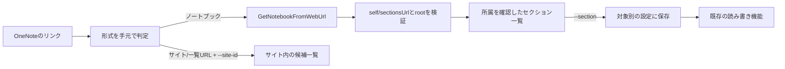

# リンクで接続先を選ぶOneNote簡易版

## ゴール
共通のプログラムにOneNoteのリンクを渡して、会社アカウントの個人用ノートとSharePointのチーム用ノートを両方使えるようにする。サイトやノートのIDをコードに固定しない。

2026-10-18のユーザー指示：まず簡易版を構築し、レビュー・動作確認する。形式的な着手確認を追加しない。指定モデルはClaude Opus 5.5 / Extra Highで、代替へ無断変更しない。

## 使う流れ
1. Claude Codeに「このOneNoteのリンクを接続先にして」と依頼する。
2. `link` がノートブック名とセクションを表示する。利用者が選び、`--section` を付けて再実行した時だけ保存する。
3. 個人用とチーム用を別の `--config` に保存し、既存の読み取り・新規作成・追記・再読み込みを使う。

## 実装（source_agent=claude-code / machine=mac-mini）
- `onenote.py link URL [--site-id ID | --root ROOT] [--section ID|名前] [--replace]`。`--site-id` は `--root sites/ID` の補助入力。省略時は設定のroot。
- リンクは手元で形式だけ判定し、取得しない。会社アカウントの `https://<tenant>(-my).sharepoint.com` と `onenote:` 付きのみ。http、他のホスト、ユーザー情報・ポート付き、短縮URL、共有リンク（`/:o:/`）、ページ・セクションのリンク、制御文字、2048文字超は送信前に拒否する。
- `-my`（個人用）は `me`/`users/ID`、それ以外（チーム）は `sites/ID`/`groups/ID` の組み合わせに限る。チーム用でrootがmeならサイトIDの指定を案内する。`sites/ホスト名,…` 形式ならホスト名とリンクの一致も確認する。
- ノートブックは `POST {root}/onenote/notebooks/GetNotebookFromWebUrl` で解決する。応答の `self` は `https://graph.microsoft.com/v1.0/{root}/onenote/notebooks/{id}` の形、`id` は応答と一致、`sectionsUrl` は `self + /sections` でなければならない。rootが指定と違えば停止する（rootがmeで `users/ID` が返る場合だけ同一とみなす）。`self`/`sectionsUrl` には要求を送らない。以後の要求はすべて指定rootの中で、既存の `validate_url` は変更していない。
- セクションは `{root}/onenote/notebooks/{id}/sections` を取得し、`parentNotebook.id` が解決したノートブックと一致しなければ停止する。読み取り・追記の既存のセクション所属確認はそのまま。
- `--section` なしでは保存しない。IDが一致するもの、なければ名前が一致するものを選ぶ。同名が複数ならIDを求める。一覧が途中で切れている（`truncated`）ときは名前では受け付けず、表示されたセクションのIDだけを受け付ける（拒否時は設定を変更しない）。設定済みの別のセクションは `--replace` なしでは上書きしない。
- サイトURLやライブラリ一覧URL（`/Forms/*.aspx`）はノートブックではないと判定する。`--site-id` があれば `{root}/onenote/notebooks` の候補を表示する（`webUrl` と、渡した一覧の範囲内かを示す `in_link_scope`）。サイトIDはこのツールでは調べない。Sites権限は追加しない。
- 403では `Notes.ReadWrite.All` が必要な場合があることを伝えて止まる。権限は自動では変更しない。400/404ではノートブックの場所のURLとroot/サイトIDの確認を案内する。エラーにリンクやトークンは含めない。
- 解決の要求はPOSTのため、既存方針どおり自動再送しない。

## 確認結果
- `tests/test_link_target.py` の模擬テスト15件：個人用（meで `users/ID` が返る）とチーム用（`--site-id`）の解決、設定の分離（個人用の設定は変わらない）、上書き防止と `--replace`、同名セクションが複数ある場合、一覧の途中切れ（201件で先頭と201件目が同名：名前指定は拒否・設定不変、表示されたIDなら保存）、不正なリンク14種（送信なし）、想定外の `self`/`sectionsUrl`/root 12種、me以外の場所への追従防止、セクション所属の不一致、403の案内（再送なし・設定不変）、404の案内、ライブラリ一覧URLの判定と候補表示、CLIの引数の流れ。
- `python3 -B -m unittest discover -s tests -v`：既存の33件と合わせて48件成功（2026-10-18、source_agent=claude-code / machine=mac-mini）。模擬テストだけで、Microsoftへの実接続・login・verify・demo.py・sync.pyは実行していない。

## 制限・未検証
- SharePoint sites/ID の実際のGraph応答で `GetNotebookFromWebUrl`、ノートブック名、self/sectionsUrl/rootの検証とセクション所属確認が成功。個人用meのリンク解決応答は模擬テストのみ。
- ブラウザ表示用の `_layouts/15/Doc.aspx` はそのままGraphへ渡すが、解決できるかは未確認。
- セクショングループ内のセクションは一覧に出ない。一覧は200件まで。
- `config.local.json` 以外の設定ファイルはGitの除外対象外。READMEではリポジトリの外に置くよう案内している。
- ユーザーのテスト先はチームサイトのドキュメントライブラリ一覧URLで、ノートブックそのものではない。ブラウザのサイトナビゲーションから「AIネイティブ研修 のノートブック」と「無題のセクション」を確認した。Graphでの取得は未確認。

## next_action
SharePointサイトはユーザー承認後の `Notes.ReadWrite.All` とローカル認証で、候補一覧→リンク解決→セクション保存→作成・読み取り・追記・再読み込みまで実機確認済み。個人用のページ読み取りも成功。個人用URLのリンク解決とWindows実機は追加確認する。詳細は [local-auth.md](local-auth.md)。

## 根拠
- https://learn.microsoft.com/en-us/graph/api/notebook-getnotebookfromweburl?view=graph-rest-1.0
- https://learn.microsoft.com/en-us/graph/api/resources/onenote-api-overview?view=graph-rest-1.0
- 既存設計：[design.md](design.md)

## レビュー（2026-10-18）
source_agent=claude-code / machine=mac-mini

- 実装はCLIの実行結果で `claude-opus-5-5` を確認。実行時に `--effort xhigh` を指定した。別モデルへのフォールバックはしていない。
- 一覧が途中で切れた場合に名前が一意とは限らない問題を模擬入力で再現し、修正した。名前指定を拒否し、確認できたID指定だけを受け付けることを確認した。
- 修正後、`python3 -B -m unittest discover -s tests -v` を実行し48件成功。`git diff --check` も通過。
- 受領したSharePointのライブラリ一覧URLを `library` と判定することを確認。ブラウザではサイトのナビゲーションから既存のOneNoteノートブックとセクションを開けた。これはCLIでの読み書き成功を意味しない。
- 当初の `notebooks` はKeychainのOSStatus -25293で停止。その後、明示的なファイル保存方式を追加して新しく認証し、個人用の本文読み取りとSharePoint側のリンク解決・作成・追記・再読み込みまで成功した。Claude Codeの認証とは別に確認した。
- 次の作業：Windows実機、個人用URLのリンク解決、実際のトークン更新を確認する。追加権限はユーザーの明示的な許可後に本人の同意だけで設定した。

## 2026-10-18 ローカル認証追加後（source_agent=claude-code / machine=mac-mini）
`--env-file` と明示的な `auth_store=file` を追加し、Mac miniでは新規認証と個人用ページの読み取りを確認した（[ローカル認証](local-auth.md)）。SharePointサイトは既存の `Notes.ReadWrite` で403となったが、ユーザーが追加権限を許可した後に `Notes.ReadWrite.All` で認証し直し、候補一覧・リンク解決・セクション保存・テストページ1件の読み書きまで成功した。Keychainの既存認証は変更していない。
