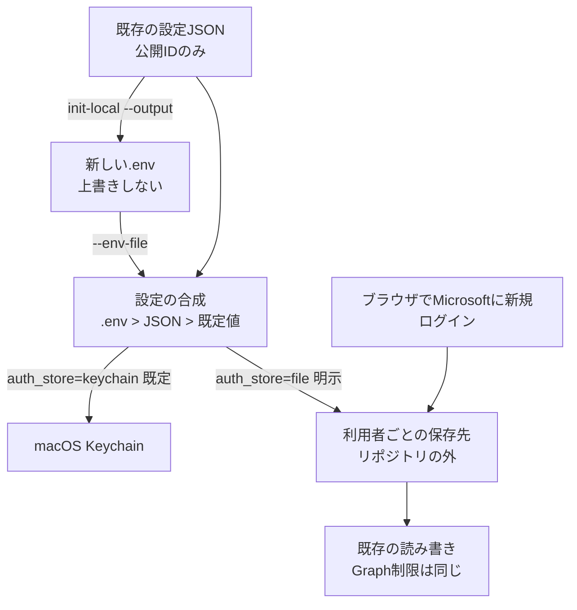

# ターミナルで設定するローカル認証（.env＋ファイル保存）

## ゴール
Mac miniをリモートで使う利用者が、失敗しているmacOS Keychainを使わずに、ターミナルだけで設定・ログインできるようにする。同じ手順をWindowsでも使えるようにする。

2026-10-18のユーザー指示：簡易版を作ってからレビューする。指定モデルはClaude Opus 5.5 / Extra High。

## 守ること
- Keychainを置き換えない。既定は今まで通りKeychain。`auth_store=file` を明示した時だけファイル保存を使う。Keychainが失敗してもファイルへ自動で切り替えない。
- Keychainの既存の認証は読まない・書き出さない。ファイル保存では新しくブラウザでログインし直す。
- `.env` は自動で読まない。`--env-file` で指定した時だけ読む。公開設定だけを書き、トークン・パスワード・シークレットは書かない。
- 保存方式の切替だけでは権限は変えない（初期値 `Notes.ReadWrite`）。共有ノート用の `Notes.ReadWrite.All` は利用者の明示的な許可後だけ設定する。Graphの送信先制限・セクション固定・リンクの制限は維持する。自動同期は停止のまま。
- 追加ソフト・依存パッケージなし（Python標準ライブラリのみ）。

## 流れ


## 設計
### 公開設定と優先順位
- 設定項目：`client_id`、`tenant`、`root`、`section_id`、`notes_scope` に、`auth_store`（`keychain`/`file`、既定 `keychain`）と `token_cache_dir`（空なら既定の場所。指定は絶対パス）を加える。既存JSONはそのまま読める。
- `.env` のキーは `ONENOTE_CLIENT_ID`、`ONENOTE_TENANT`、`ONENOTE_ROOT`、`ONENOTE_SECTION_ID`、`ONENOTE_NOTES_SCOPE`、`ONENOTE_AUTH_STORE`、`ONENOTE_TOKEN_CACHE_DIR` だけ。
- 優先順位：configureの引数 > `--env-file` > `--config` のJSON > 既定値。configure以外のコマンドは、`.env` > JSON > 既定値で合成した設定を使う。
- `--env-file` を指定した場合、既定の `config.local.json` がなくても `.env` だけで動く。`--config` を明示したのにファイルがなければ止まる（設定の取り違え防止）。
- 保存するコマンド（configure、`link --section`）は `--config` のJSONだけに書く。`.env` は書き換えない。`.env` の値をJSONへコピーしない。`.env` が決めている項目を別の値に変えようとした場合は、実行時に `.env` が優先されて反映されないため保存せずに止まる。

### .envの読み方
- `KEY=value` だけ。空行と `#` で始まる行は無視。値は `"…"` か `'…'` で囲める（中の同じ引用符は不可）。
- 変数展開・コマンド実行・エスケープ処理はしない。`$` と `` ` `` を含む値は拒否する。`~` も展開しないため、パスは絶対パスで書く。
- 許可外のキー、形式の誤り、重複、token/password/secret等の名前のキーは拒否する。エラーには行番号だけを出し、値は表示しない。16KB超・UTF-8以外・通常ファイル以外は拒否する。

### init-local
- `python3 onenote.py [--config JSON] init-local --output PATH [--client-id ID --tenant ID] [--token-cache-dir DIR]`
- 既存JSONの公開ID（アプリID・テナント・権限）を検証して、新しい `.env` を作る。`auth_store=file` を設定する。接続先（root・セクション）はJSONのまま（`--config` で個人用・チーム用を分ける）。
- 新規作成のみ（排他的作成）。既にあれば内容を読まず・上書きせずに止まる。作成したファイルの中身は表示しない。表示するのは作成したパス、保存方式、次のloginコマンドだけ。
- トークンは読まない・移行しない。JSONがなければ `--client-id` と `--tenant` を求める。値が不正なら作らない。読み取り元と作成先を混同しないよう、`--env-file` との同時指定は拒否する。

### ファイル保存（FileTokenStore）
- 既定の場所：macOS `~/Library/Application Support/ClaudeOneNoteGraph/token-cache`、Windows `%LOCALAPPDATA%\ClaudeOneNoteGraph\token-cache`（LOCALAPPDATAがなければ `ホーム\AppData\Local`）、その他 `~/.local/state/ClaudeOneNoteGraph/token-cache`。
- ファイル名は `onenote-token-<SHA-256>.json`。ハッシュはKeychainと同じ「テナント:アプリID:権限」から作る。rootとセクションは含めないため、同じ利用者の個人用・チーム用の設定は同じログインを使える。
- 操作は exists / get / put / delete。保存は同じフォルダの非公開の一時ファイルに書いてから置き換える。サイズ上限64KB。読み込んだ内容は `access_token`・`refresh_token`・`expires_at` の型を確認し、不正なら内容を表示せずに再ログインを案内する。
- シンボリックリンク・通常ファイル以外は拒否する。POSIXではフォルダ0700・ファイル0600で作り、所有者が違う・グループ/他者が読み書きできる既存のフォルダ・ファイルは変更せずに止める（chmodで直さない）。
- Gitの作業フォルダ（親に `.git` があるところ）、このツールのフォルダ、OneDrive/クラウド同期と分かるフォルダの中は拒否する（同期フォルダの判定は名前による簡易判定）。
- Windowsでは利用者ごとのAppDataに置く。ファイルのアクセス権（ACL）は設定しないが、中身はDPAPI（現在のWindowsユーザー単位、画面を出さない設定）で暗号化し、ファイル名は `onenote-token-<ハッシュ>.dpapi` にする（2026-10-18追記）。

### 認証
- `auth_store` で保存先を選ぶ。テスト用に保存先を外から渡す仕組みは残す。Keychainの呼び出しは `auth_store=keychain` の時だけ。
- ログイン完了の表示は保存先に依存しない文言にする。`status` は保存方式、ファイルの場所、ログイン済みかだけを表示する。`logout` は選んだ保存先の自分のファイル（項目）だけを削除する。
- 更新トークンでの更新は同じ。新しい更新トークンが返れば保存し直す。

## 確認方法
- 模擬データと一時フォルダだけで単体テストを追加する。実際のlogin・status・notebooks・verify・demo.py・sync.pyは実行しない。
- `python3 -B -m unittest discover -s tests -v` と `git diff --check`。

## 実装（source_agent=claude-code / machine=mac-mini、2026-10-18）
変更：`onenote.py`、`.gitignore`、`.env.example`（新規・架空の値のみ）、`tests/test_local_auth.py`（新規）、README、design.md。

```sh
python3 onenote.py [--config JSON] init-local --output .env [--client-id ID --tenant ID] [--token-cache-dir 絶対パス]
python3 onenote.py --env-file .env login | status | notebooks | sections | pages | read … | logout
python3 onenote.py [--config JSON] configure --auth-store keychain|file [--token-cache-dir 絶対パス]
```

設計からの補足・変更点：
- `check_config` に `auth_store`・`token_cache_dir` を追加。`.env` とJSONの `token_cache_dir` は絶対パスのみ。`configure`・`init-local` の `--token-cache-dir` は実行時のフォルダを基準に絶対パスへ変換してから保存・検証する。
- `--config` の既定値の判定を変えた（明示した `--config` がない場合は `.env` があっても止まる）。`init-local` と `--env-file` の同時指定は拒否する。
- 保存先の検証：Gitの判定はホームフォルダ自体（dotfilesのGit）を対象外にした。ホームより下の `.git`、このツールのフォルダ、名前が `OneDrive…`・`CloudStorage`・`Mobile Documents`・`Dropbox` 等のフォルダを拒否する。Windowsでは再解析ポイント（シンボリックリンク・ジャンクション・OneDriveのクラウドファイル等、`st_reparse_tag`）も拒否する。
- 読み込みは `lstat` で確認してから `O_NOFOLLOW` で開き、開いたものを `fstat` で再確認する（FIFOでも止まらない）。保存は同じフォルダの一時ファイル（`O_EXCL`、0600）→fsync→置き換え→読み戻し確認。置き換え先がリンク・他人の・権限の広いファイルなら置き換えない。
- `init-local` は `.env` を認証キャッシュと同じフォルダに作らない。作成内容を自分のパーサーで読み直してから作る。
- `save_config` はtoken/secret/password等の名前の項目を含む設定を保存しない（値は表示しない）。
- 予期しないOSErrorは種類名だけを表示する（内容・パスの中身は出さない）。
- ブラウザの完了画面の文言を「ターミナルの接続結果を確認してください」に、CLIの説明を「Claude Code用」にした。

## 確認結果（2026-10-18、source_agent=claude-code / machine=mac-mini）
- `tests/test_local_auth.py` の模擬テスト21件：`.env` の読み取り（BOM・コメント・引用符）、不正行13種の拒否と値を出さないこと、16KB超・UTF-8以外・フォルダ・存在しないファイル、`.env.example` が架空の値でfileを選ぶこと、優先順位（`.env` がJSONより優先・JSONは変わらない・`--env-file` なしはKeychainのまま）、`.env` だけで動くこと・明示した `--config` がなければ止まること、configure/linkが `.env` の項目を上書きしないこと（linkは通信前に停止）・`.env` の値をJSONへコピーしないこと・秘密値のような項目の保存拒否、保存先の明示選択とSecurity.frameworkを読み込まないこと、Keychain失敗時にファイルへ切り替えないこと、個人用・チーム用で同じログイン・権限/テナント/アプリIDで分かれること、OSごとの既定の場所、0700/0600と置き換え・一時ファイルが残らないこと、壊れた・大きい・型の違う認証キャッシュ（内容を出さない）、シンボリックリンク・FIFO・リンクされたフォルダの拒否（対象を変更しない）、権限の広いフォルダ・ファイルの拒否（chmodしない）、Git・このツール・OneDriveのフォルダと相対パスの拒否、更新トークンの更新の保存、ログイン表示が保存先に依存せずトークンを出さないこと、statusが内容を出さないこと・logoutが選んだ保存先の自分のファイルだけを消すこと、init-localの新規作成・上書きしないこと（既存・壊れたリンク）・入力不足/不正で作らないこと・トークンに触れないこと。
- テスト中に1件の不具合を見つけて修正：既存JSONがない状態の `init-local` が、引数を反映する前の空の既定値を検証して失敗していた。
- `python3 -B -m unittest discover -s tests -v`：既存48件と合わせて69件成功。`git diff --check` 問題なし（追跡済みファイルのみが対象）。
- 実際のlogin・status・notebooks・verify・demo.py・sync.pyは実行していない。実際の `.env`・認証キャッシュ・Keychainは読んでいない。テストは既定の設定ファイルと既定の保存先を一時フォルダに差し替え、Keychainを呼ぶと失敗するようにして実行した。
- このセッションでは `onenote.py --help` の実行が許可されず、CLIのヘルプ表示は直接確認していない（引数の流れは `main()` を模擬実行するテストで確認）。

## 制限・未検証
- macOS・Linuxのファイル保存は暗号化しない平文（WindowsはDPAPIで暗号化）。リポジトリ・OneDrive・SharePointの外に置き、`.env` とは別にする。PC間でコピーしない。利用者はそれぞれ自分のPCでログインする。
- Mac miniでの新規ログイン・保存・個人用ページ読み取りは下記のとおり確認済み。実際の更新トークンの更新・Windows実機は未確認。
- Windowsの実機確認は未実施。DPAPIで暗号化するため、別のWindowsユーザー・別のPCでは復号できない（同じユーザーとして動くプログラムは復号できる）。Python 3.9〜3.11のWindowsでの `O_BINARY`・再解析ポイントの判定も実機では未確認。
- 同期フォルダの判定は名前による簡易判定。SharePointのライブラリを同期したフォルダ（組織名のフォルダ等）は検出できない。
- 2つのプロセスが同時に更新すると後から保存した方が残る（Keychainと同じ）。
- `sync.py` は `--env-file` に対応しない（同期は停止中で対象外）。Windowsでは `fcntl` の代わりに `msvcrt` でロックする（2026-10-18追記）。JSONに `auth_store=file` を設定した場合はファイル保存を使う。
- SSHのポート転送でのリモートログインは未確認。

## レビューとMac mini実機確認（2026-10-18）
source_agent=claude-code / machine=mac-mini

- 指定された `claude-opus-5-5` / `xhigh` で実装したことをCLIの実行結果で確認。69件の模擬テスト、CLIヘルプ、`git diff --check` も確認した。
- 新規PC向けの `init-local` の不具合を再現し、修正後に架空のIDで成功を確認した。
- Mac miniに専用の公開設定 `.env` を新規作成した。既存設定は上書きせず、Keychainの認証は読まず・移行せずに、Microsoftのブラウザログインを新しく行って成功した。
- `status` は `auth_store=file` / 認証あり。認証キャッシュのフォルダ0700・ファイル0600を内容を開かずに確認した。
- 個人用のノートブックとセクションの一覧を取得し、別の検証用公開設定で3ページの一覧を取得。1ページの本文取得も成功（本文は報告せず文字数のみ確認）。
- 元のJSONに残っていたセクションIDは現在のアカウントで404になった。元のJSONは変えず、現在の一覧から検証用設定を別に作って確認した。
- ユーザー指定のSharePointサイトは `Notes.ReadWrite` で403。ユーザーの明示的な追加許可後、別の設定と `.env` で `Notes.ReadWrite.All` の新規ログインを行った。「組織の代理として同意する」は選択せず、本人の同意だけを実施した。個人用の設定・認証は残した。
- 追加権限でサイト内候補一覧が成功し、Graphが返した実際のSiteAssets配下のリンクからノートブックとセクションを解決。選択したセクションをチーム用設定に保存した。
- チーム用設定で `verify` を1回実行。接続テスト用の架空ページ1件（2026-10-18 11:22作成）を作り、create / read / append / read-back の全チェックで `verified: true`。テストページは確認用に残した。
- 既存ページの更新・削除・自動同期は行っていない。Windowsでの実行成功は主張しない。

## next_action
Mac miniではローカル認証、個人用ページの読み取り、SharePointチーム用リンクの解決と読み書きが確認済み。利用時は個人用とチーム用の設定・`.env`の組を選ぶ。Windowsは別のPCでREADMEの初期設定から実行し、認証・読み取り・テスト用セクションでの書き込みを確認する。実トークン更新はまだ確認していない。同期は再開しない。
